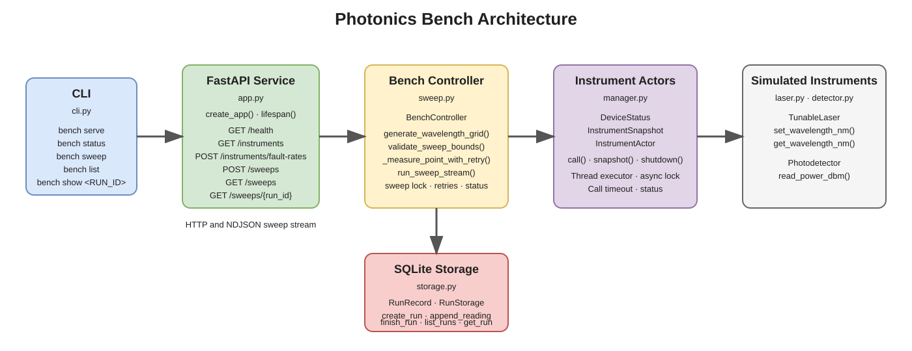

# Photonics Bench Instrument Service

A Python service and command-line client for running wavelength sweeps on a
simulated photonics bench: a tunable laser coupled to a photodetector.

The service exposes an HTTP API for instrument status, sweep control, and
historical results. The `bench` CLI uses that API, and third-party scripts can
use it directly.

## Architecture



Editable source: [photonics-bench-architecture.drawio](docs/photonics-bench-architecture.drawio)

## Agentic AI Usage

This project was built using an AI-assisted development workflow, combined
with human architectural oversight and verification.

I defined the core requirements and implementation boundaries:

- Separate classes for a tunable laser and a photodetector.
- Simulated timeout and corrupt-response fault rates that model expected instrument
  failures.
- Independent locking for each instrument, so one instrument's lock is held only
  for its own operation.
- Asynchronous operation with a dedicated worker thread per instrument, preventing
  a slow instrument call from blocking the event loop or another instrument.
- Reuse of the shared instrument actor for additional instruments through the same
  actor and subclass patterns.
- A bench controller that coordinates wavelength sweeps, streams progress and
  results through FastAPI, and persists completed sweep data in SQLite.

I was new to several FastAPI and asynchronous-programming patterns, even though
I had encountered similar concepts previously. AI accelerated implementation,
but I remained responsible for requirements, architectural decisions, and
reviewing the resulting behavior.

I validated the implementation by running the unit test suite, running sweep
scenarios, and inspecting the generated SQLite database file. The tests covered
individual behavior and fault conditions, while sweep runs and database inspection
confirmed the streamed results and stored run and reading data.

There is substantial scope to test additional scenarios and edge cases. Further
unit and integration tests would improve coverage across instrument behavior,
concurrency, API streaming, persistence, and failure recovery.

## Requirements

- Python 3.11 or newer

## Quickstart

From the project directory:

```bash
python -m venv .venv
source .venv/bin/activate        # Windows: .venv\Scripts\activate
pip install -e ".[dev]"
pytest
```

In one terminal, start the service:

```bash
bench serve
```

By default, the service listens on `http://127.0.0.1:8000`. In another
terminal, use the CLI:

```bash
bench status
bench sweep --start 1549.5 --stop 1550.5 --step 0.05 --notes "Resonance check"
bench list
bench show <RUN_ID>
```

The interactive API documentation is available at
<http://127.0.0.1:8000/docs> while the service is running.

## CLI commands

- `bench serve` starts the API service. Options include `--host` and `--port`.
- `bench status` displays service and instrument status.
- `bench sweep` runs a sweep and prints streamed measurements.
- `bench list` lists previously recorded runs.
- `bench show <RUN_ID>` displays a run's metadata and readings.

The CLI connects to `http://127.0.0.1:8000` by default. Set
`BENCH_SERVICE_URL` or pass `--url` to a client command to use a different
service URL.

## HTTP API

The FastAPI application provides these endpoints:

| Method | Path | Purpose |
| --- | --- | --- |
| `GET` | `/health` | Service and instrument health, including the active run |
| `GET` | `/instruments` | Current instrument states |
| `POST` | `/instruments/fault-rates` | Update simulated instrument fault rates |
| `POST` | `/sweeps` | Validate and start a wavelength sweep |
| `GET` | `/sweeps` | List stored sweep runs |
| `GET` | `/sweeps/{run_id}` | Retrieve a run and its readings |

`POST /sweeps` accepts JSON fields `start_nm`, `stop_nm`, and `step_nm`, with
optional `operator` and `notes`. It streams newline-delimited JSON (NDJSON):
one JSON event per line, with `started`, `point`, and `complete` event types.
This lets clients display each measurement as it arrives. Wavelengths outside
the laser's 1500–1600 nm operating range are rejected. A second simultaneous
sweep is rejected with HTTP `409 Conflict`.

FastAPI validates request fields and serves the OpenAPI schema at
`/openapi.json`.

## Configuration

The service reads settings from environment variables corresponding to the
field names below (uppercase, with no `BENCH_` prefix):

| Variable | Default | Description |
| --- | --- | --- |
| `LASER_TIMEOUT_RATE` | `0.05` | Simulated laser timeout probability |
| `LASER_CORRUPT_RATE` | `0.02` | Simulated malformed laser response probability |
| `DETECTOR_TIMEOUT_RATE` | `0.05` | Simulated detector timeout probability |
| `DETECTOR_CORRUPT_RATE` | `0.02` | Simulated malformed detector response probability |
| `RESONANCE_NM` | `1550.12` | Simulated detector resonance wavelength |
| `DB_PATH` | `bench.db` | SQLite database path |
| `HARDWARE_CALL_TIMEOUT_S` | `1.0` | Maximum wait for an individual instrument call |
| `MAX_RETRIES_PER_POINT` | `2` | Retries after the first measurement attempt |

Fault rates can also be updated while the service is running with
`POST /instruments/fault-rates`.

## How it works

- The simulated laser accepts wavelengths from 1500 to 1600 nm.
- The simulated detector models a Lorentzian resonance dip with measurement
  noise.
- Each instrument is called through its own single-thread executor and async
  lock. This serializes calls to that instrument and keeps blocking driver
  calls off the async event loop.
- A bench-wide lock allows only one sweep at a time. Health and history
  requests remain available while a sweep is running.
- Sweep metadata and readings are stored in SQLite using WAL mode. Run
  provenance includes operator, notes, sweep parameters, retry configuration,
  instrument details, fault rates, and the available Git revision.

## Scope and limitations

This version uses simulated instrument drivers. The tunable laser and
photodetector interfaces should be reviewed and extended so each driver includes
all properties needed for future or physical instrument integration.

The SQLite database is local to the service process and is not a shared or
remote database. This version does not include a web client; interaction is
provided through the terminal CLI and HTTP API.

This version does not include physical PyVISA/serial drivers, a wavemeter, or a
distributed lease manager. A sweep is tied to its streaming HTTP response; if
the client disconnects, the run is marked aborted.

## Tests

Run the test suite with:

```bash
pytest
```
